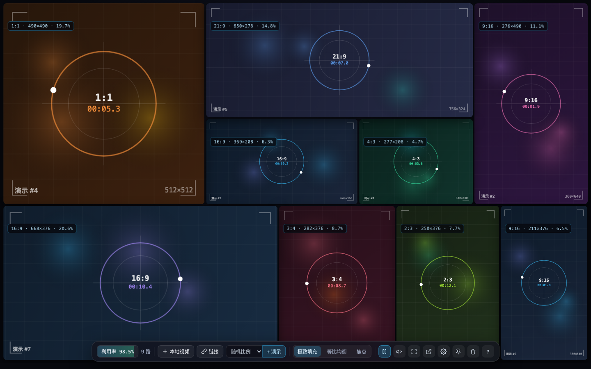

# 自适应无损比例多路视频墙 (Adaptive Video Wall)

一款零依赖的网页自适应多路视频播放器 & Chrome Manifest V3 扩展程序：无论同时打开多少个横屏、竖屏或方屏视频，都在**严格保持每个视频原始宽高比不变（零裁剪、不变形、不重叠）**的前提下，实时求解最优二维空间排布并尽可能占满屏幕。

## 效果演示



> 上图为 `1:1`、`21:9`、`16:9`、`4:3`、`9:16`、`3:4`、`2:3` 共 9 路不同比例视频在 1440×900 屏幕下的实时混排效果（屏幕利用率 **98.5%**，每个画面中心参考圆均保持正圆，零拉伸、零裁剪）。

## 核心特性

- **精确自适应排版引擎**（`src/layoutEngine.js`）
  - 基于精确仿射切片树（Slicing Tree）与多策略协同搜索（等高行/等宽列居中、子集动态规划、目标比例递归 BSP、局部树微调），支持任意数量与混排比例。
  - 支持「极致填充」「等比均衡」「焦点主画面」三种模式，以及间距（Gap）和尺寸均衡度调节。
  - 增减视频、拖拽互换位置或缩放窗口时复用原有 `<video>` DOM 节点，播放不中断。
- **Chrome 扩展一键同步网页视频**（`extension/`）
  - **右键菜单同步**：在任意网页视频上右键 →「添加到自适应视频墙」（即使有透明播放器遮罩也能准确命中）。
  - **点选模式 / 弹窗扫描**：快捷键 `Alt+Shift+V` 进入高亮选框点选模式，或点击扩展图标跨 frame 扫描当前页视频列表。
  - **双级捕获**：优先通过 `captureStream()` + 本地 WebRTC 环回推流（支持 Bilibili、YouTube、Twitch 等 `blob:` MSE 流），跨域直链自动回退直链同步；同步期间自动静音原标签页并启用后台保活机制。
- **视频保存与录制**
  - 右键「保存该视频到本地」、弹窗「保存」或视频墙单路下载按钮：直链视频直接下载，`blob:`/实时流自动通过 `MediaRecorder` 录制并保存为 `.webm`。

## 安装 Chrome 扩展

1. 打开 Chrome 地址栏进入 `chrome://extensions/`
2. 打开右上角 **开发者模式**
3. 点击 **加载已解压的扩展程序**，选择本仓库根目录

也可以直接用浏览器打开根目录下的 `index.html` 作为独立本地多路视频播放器使用。

## 运行测试

```bash
node --test tests/layoutEngine.test.mjs tests/extensionMessaging.test.mjs
```
